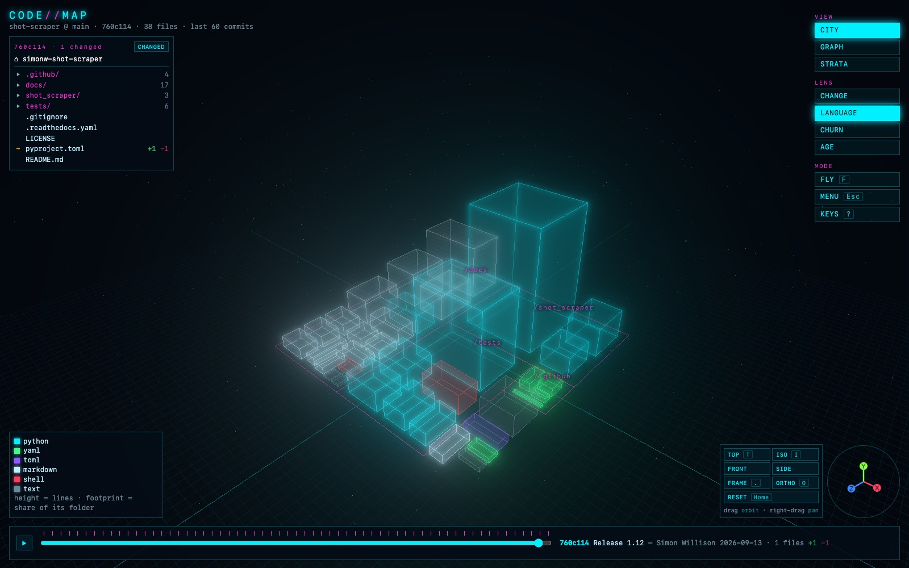

# CodeMap

A 3D, Tron-style map of a git repository. Files are towers, folders are districts, and the commit
history is a timeline you can scrub or play. Load any public GitHub repo in the browser, open a
folder from your own disk, or scan a local checkout.

**Live:** https://codemap-3d.netlify.app · Try a repo: `https://codemap-3d.netlify.app/?gh=owner/name`



## What it shows

| View | Geometry |
|------|----------|
| City (`1`) | file = tower (height = lines, footprint = share of its folder), folder = district |
| Graph (`2`) | the import network in free space |
| Strata (`3`) | each tower is a stack of slabs, one per commit that touched it |

Lenses (`L`) colour the towers: **change** (what the selected commit touched, or the uncommitted
working tree), **language**, **churn** and **age**. The timeline steps through commits; its last
stop is the working tree. Click a tower for the code panel: source with a blame gutter, dirty
lines, per-commit diffs and symbols. A selected file draws arcs to what it imports and what imports
it.


## Getting around

Press `?` in the app for every key and mouse control.

- **Camera presets** (bottom right): TOP (`T`) is an orthographic top-down map where dragging pans
  like a map; ISO (`I`), FRONT and SIDE; FRAME (`.`) fits the selection; ORTHO (`O`) toggles
  orthographic; RESET (`Home`) goes back to the whole repo. The axis gizmo swings the camera to
  look along the axis you click.
- **Folder tree** (top left): the repo at the current commit, each folder with its count of added,
  modified and deleted files. CHANGED hides untouched files.
- **Focus**: click a folder in the tree, click a folder label in the scene, or double-click a tower
  to focus its folder. The rest of the city slides away and fades; `Backspace`, `Esc` (with nothing selected) or the
  breadcrumb goes back up; `Esc` at the top level opens the menu.
- `/` searches files, `←` `→` step commits, `Space` plays the history, `F` free-flies (WASD).

## Run it locally

Needs Node 20.19+ (or 22.12+), Python 3.10+ and git.

```sh
cd web
npm install
npm run dev                     # http://127.0.0.1:5179
```

### Scan a local repo

```sh
npm run scan -- ../path/to/repo   # relative to where you run it
```

The scanner (`scan/scan.py`, standard library only) writes `web/local-maps/<repo>.json` with each
file's text, symbols, imports and per-line blame, the working tree's dirty lines, and every commit
with its patches. Every scanned repo appears in the menu (`Esc`) and at `?repo=<name>`; the menu
can rescan the current one.

> **Local scans contain the full source of the repo.** `web/local-maps/` is git-ignored and only
> the dev server serves it. It never goes into a build. Don't copy a private scan into
> `web/public/`.

### Load from GitHub

Menu → Load from GitHub, or open `?gh=owner/name&n=50`. The browser reads the tree, the last `n`
commits and their diffs from the GitHub API, and file contents from `raw.githubusercontent.com`.
Nothing is cloned and there is no backend in the loop. Without a token GitHub allows 60 API calls
an hour. A token (sign in, or paste one) raises that to 5,000 and reaches private repos.

Tokens are kept in the tab's `sessionStorage` and sent only to `api.github.com`. The live site's
Content-Security-Policy only lets the page talk to itself, the GitHub API and the raw-content
host.

### Open a local folder

Menu → Open a local folder, or open `?local&n=50`, then CHOOSE FOLDER. This works the same on the
live site and under `npm run dev`, with no scan step: the browser's folder picker hands the files
to the page and everything is read inside the tab. **Nothing is uploaded**, and the CSP would block
the page from sending the files anywhere but GitHub.

History comes from the folder's own `.git`: the last `n` commits on the current branch's
first-parent line (a merge shows everything it brought in), with their diffs, and the working
tree's dirty lines against HEAD. The file list follows the folder's `.gitignore` files and
`.git/info/exclude`, and skips nested repositories as git does. Your global ignore file
(`~/.config/git/ignore`) sits outside the folder, so it isn't applied. Compared with the scanner
there is no blame, renames are found only when the contents are identical, and a worktree or
submodule (where `.git` is a pointer file) opens without history. Chrome, Edge and Arc read the folder lazily. Firefox and Safari read every file in it up
front, `node_modules` included, so use Chrome for big repos.

## Deploy your own (Netlify)

`netlify.toml` builds `web/`, serves `web/dist`, sets the security headers and deploys one function,
`web/netlify/functions/github-token.mjs`. The page works without sign-in (public repos, or a pasted
token). To add the **Sign in with GitHub** button:

1. Create a **GitHub App** (preferred: read-only *Contents* and *Metadata*, the user picks which
   repos) or a classic OAuth App. Set the callback URL to the site root, e.g.
   `https://<site>.netlify.app/`.
2. Set Netlify environment variables: `GITHUB_CLIENT_ID` and `GITHUB_CLIENT_SECRET` (server-side
   only), `VITE_GITHUB_CLIENT_ID` (public, baked into the bundle at build time), and
   `VITE_GITHUB_SCOPE=repo` only for a classic OAuth App.
3. Deploy. The function swaps the OAuth `code` for a token and returns only the token; the client
   secret never reaches the browser.

For local sign-in, copy `web/.env.example` to `web/.env.local`; `npm run dev` serves the same
function.

The demo maps shipped with the site live in `web/public/demo/`. Add one with
`GITHUB_TOKEN=... npm run demo -- owner/name 60`, for a **public** repo only.

## Project layout

`AGENTS.md` at the root is the map of the code, with a further `AGENTS.md` in each directory for
that layer's rules. In short: `scan/` is the local scanner, `web/src/` is the app (Three.js, no
framework), `web/netlify/functions/` is the OAuth token exchange.

## Security

See [SECURITY.md](SECURITY.md) to report a vulnerability.

## License

[MIT](LICENSE). The demo maps in `web/public/demo/` are derived from third-party repositories under
their own licenses; see [THIRD_PARTY_NOTICES.md](THIRD_PARTY_NOTICES.md).
